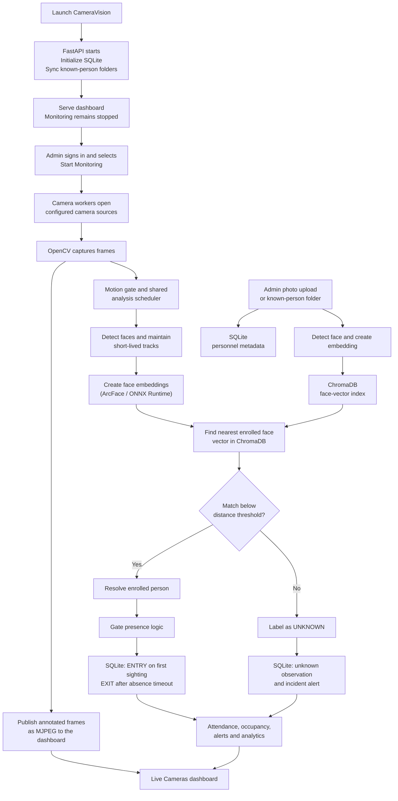

# CameraVision — Campus Monitoring Prototype

## Project description

CameraVision is a campus camera-monitoring prototype aligned with the **Multi-Camera Campus Intelligent System** reference. Its goal is to help an administrator view camera feeds, recognize enrolled people, and review camera-generated attendance events and alerts from one dashboard. The FastAPI backend serves both the dashboard and APIs; OpenCV handles camera frames, a face-recognition pipeline compares faces with enrolled identities, and SQLite and ChromaDB store the system's records and face embeddings.

The application is designed so monitoring begins only when an administrator starts it from the dashboard. It currently uses one entrance camera by default, while allowing additional cameras to be registered. The present attendance output is an event log, not a complete school attendance product with class rosters, schedules, or authoritative daily present/absent records.

> **Scope:** This repository is a working prototype, not a complete school information system. It currently starts with one entrance camera by default, although additional cameras can be registered. It uses personnel records that can be assigned roles such as Student or Teacher; it does not yet provide a complete class, section, timetable, or student-roster workflow.

## What it does today

- Serves a browser dashboard and backend API from one FastAPI application.
- Lets an administrator start and stop camera monitoring from **Live Cameras**. Camera workers do not start automatically when the server launches.
- Displays live camera video and camera status.
- Enrolls personnel photos and compares detected faces with enrolled identities.
- Logs recognized gate events and displays attendance and other available analytics.
- Provides alerts and optional event evidence clips. It does **not** continuously record video.
- Supports an optional Gemini-powered copilot; without a configured API key, the application uses its rule-based fallback.

## How CameraVision works

The diagram shows the implemented flow from startup and enrollment through camera processing, matching, event storage, and the dashboard. Monitoring is not started automatically.



### Workflow summary

1. **Startup:** FastAPI initializes SQLite and synchronizes folder-based enrollments. Camera workers remain stopped.
2. **Enrollment:** An administrator uploads a person's photo or adds it to `data\known_persons`. The application creates a face embedding in ChromaDB and stores personnel metadata in SQLite.
3. **Start monitoring:** An administrator starts camera monitoring from **Live Cameras**.
4. **Capture and analyze:** OpenCV captures frames. Frames are made available to the live MJPEG feed; motion gating and the shared scheduler limit when the more expensive face analysis runs.
5. **Identify:** The face pipeline detects and tracks faces, generates embeddings, and compares them with enrolled vectors in ChromaDB.
6. **Record events:** A recognized person can generate an `ENTRY` event when first seen and an `EXIT` event after the configured absence timeout. An unrecognized observation can create an `UNKNOWN` attendance record and an alert.
7. **Review:** The dashboard displays the live feed, camera status, attendance events, occupancy, alerts, and available analytics. Stop monitoring from the dashboard when finished.

The report's broader vision includes school-specific rosters, multi-camera identity tracking, and a campus AI assistant. Those should be treated as future work unless explicitly listed as implemented above.

## Technology and implementation

| Technology | How this project uses it |
| --- | --- |
| Python | Backend language and camera/analytics services. |
| FastAPI + Uvicorn | Serves the REST API, MJPEG video feeds, WebSocket events, and the static dashboard. |
| HTML, CSS, vanilla JavaScript, Tailwind CSS | Browser dashboard. The frontend is **not React** and has no separate frontend development server. |
| OpenCV | Camera capture, image/frame processing, and video streaming. |
| InsightFace + ONNX Runtime | Preferred face pipeline: SCRFD face detection and ArcFace embeddings. The `auto` backend may fall back to the legacy `face_recognition`/dlib pipeline when InsightFace or its model is unavailable. |
| ChromaDB | Persistent vector search for enrolled face embeddings. |
| SQLite + SQLAlchemy | Structured records, including personnel, attendance events, alerts, and analytics data. The current database is **not PostgreSQL**. |
| Pydantic Settings | Runtime configuration from environment variables and `.env`. |
| Gemini API (optional) | Copilot responses when `GEMINI_API_KEY` is configured; otherwise a rule-based fallback is used. |
| Pytest | Backend tests. |

### Reference proposal vs. this repository

| Reference concept | Current project status |
| --- | --- |
| React frontend | Not used; the dashboard is static HTML/JavaScript with Tailwind CSS. |
| FastAPI backend | Implemented; it also serves the frontend. |
| PostgreSQL records | SQLite is used locally through SQLAlchemy. |
| OpenCV camera processing | Implemented. |
| YuNet face detection | Not the configured detector. InsightFace SCRFD is preferred; dlib is a fallback. |
| InsightFace / ArcFace recognition | Implemented through the preferred ONNX Runtime pipeline. |
| ChromaDB vector search | Implemented for face embeddings. |
| Multiple campus cameras | The app supports registering cameras, but the default configuration contains one entrance camera. Full campus-wide, cross-camera identity tracking and deployment are not implied. |
| Student/class/section attendance | The personnel model can represent students and teachers, but a full school roster, class schedule, and student-specific attendance workflow remain future work. |
| Natural-language campus assistant | A basic optional copilot endpoint exists; a complete school-domain assistant is future work. |

## Requirements

- Windows, macOS, or Linux
- Python 3.12 recommended
- A webcam, or a supported network camera stream
- Internet access on first use if the face-recognition model needs to be downloaded

On Windows, installing InsightFace or its dependencies may require Microsoft C++ Build Tools. If the optional legacy dlib backend must be installed from source, CMake and a compatible C++ toolchain may also be required.

## Setup and run on Windows

Run these commands from PowerShell in the cloned repository:

```powershell
py -3.12 -m venv .venv
.\.venv\Scripts\Activate.ps1
python -m pip install --upgrade pip
python -m pip install -r requirements.txt
Copy-Item backend\.env.example backend\.env
```

Open `backend\.env` and set a private `JWT_SECRET` and a strong `ADMIN_PASSWORD` before using the application beyond a local demo. The `.env` file is ignored by Git.

Start the backend **from the `backend` directory** so its `.env` file is loaded:

```powershell
Set-Location backend
python -m uvicorn main:app --reload --host 127.0.0.1 --port 8000
```

Open:

- Dashboard: <http://127.0.0.1:8000/>
- API documentation: <http://127.0.0.1:8000/docs>

The dashboard is served by FastAPI; you do not need to start a separate frontend server. Stop the server with `Ctrl+C`.

## Sign in and start the camera

- Default local demo login: **admin** / **admin123**
- Change the default password and `JWT_SECRET` in `backend\.env` before deployment or exposing the app to a network.
- After signing in, open **Live Cameras** and select **Start Monitoring**. The server alone does not start camera capture.
- The default camera is `cam_entrance`, using camera source `0` (the first local webcam). If the preview is unavailable, check Windows camera privacy permissions, confirm that another app is not holding the camera, and verify the source configured for the camera.
- Additional cameras can be registered in the dashboard where available, or through the authenticated camera API. Camera sources can be webcam indices or RTSP/MJPEG URLs. Avoid putting camera credentials in source-controlled files.

Useful camera endpoints:

| Endpoint | Purpose |
| --- | --- |
| `GET /api/stream/monitoring` | Check whether monitoring is running. |
| `POST /api/stream/monitoring/start` | Start monitoring (administrator authentication required). |
| `POST /api/stream/monitoring/stop` | Stop monitoring (administrator authentication required). |
| `GET /api/stream/cameras` | List configured cameras. |
| `GET /api/stream/video_feed?camera_id=cam_entrance` | MJPEG video feed. |
| `GET /api/stream/snapshot?camera_id=cam_entrance` | Latest frame as an image. |
| `GET /api/analytics/attendance` | Recent attendance events. |
| `GET /api/analytics/dashboard` | Dashboard summary. |

Authenticate to protected endpoints using the token returned by `POST /api/auth/login`. The interactive API documentation at `/docs` lists the available routes and request schemas.

## Enroll personnel

The simplest method is to use the personnel section in the dashboard and upload a clear photo for each person. Enrollment creates a personnel record and stores face data for matching. The authenticated enrollment endpoint is `POST /api/personnel/enroll`. Use only photos you are authorized to process.

The application also syncs folder-based enrollments from `data\known_persons` at startup and watches that directory while running. Each person folder can contain one or more JPG/PNG photos and an optional `info.json`:

```text
data/
└── known_persons/
    └── STU001_Alex_Smith/
        ├── info.json
        └── front.jpg
```

Example `info.json`:

```json
{
  "name": "Alex Smith",
  "role": "Student",
  "department": "General",
  "email": "",
  "phone": ""
}
```

The folder prefix (`STU001` above) is used as the person ID. A clear, front-facing photo is more likely to produce a usable face embedding. Restarting is not normally required when adding files because the directory watcher is active.

## Data locations

Runtime data is created under the repository's `data\` directory by default:

| Path | Contents |
| --- | --- |
| `data\surveillance.db` | SQLite personnel, attendance, alert, and related structured records. |
| `data\vector_db\` | Persistent ChromaDB face embeddings. |
| `data\known_persons\` | Folder-based enrollment photos and metadata. |
| `data\clips\` | Event-triggered evidence clips, not continuous recordings. The default retention is 72 hours. |
| `data\logs\` | Application logs. |
| `data\snapshots\` | Optional unknown-face snapshots; disabled by default. |

Back up the database, enrollment photos, and vector database together if you need to preserve the ability to match existing identities. Treat all images, embeddings, camera URLs, and logs as sensitive data.

## Tests

From the repository root, with the project environment activated:

```powershell
pytest -q
```

The test fixtures isolate their database and camera settings; passing tests do not verify that a physical webcam, network camera, or downloaded recognition model works on a particular machine.

## Privacy and deployment notes

- Obtain appropriate consent and authorization before enrolling people or monitoring a location. Follow applicable privacy, biometric-data, and education regulations.
- The default credentials and signing secret are for local development only. Configure unique values, restrict network access, and use HTTPS and appropriate access controls before deployment.
- The application has a single administrator login configuration; it is not a complete multi-role Admin/Teacher authorization system.
- Unknown-face snapshots are disabled by default. Evidence clips are event-driven and expire according to the configured retention policy.
- Do not commit `.env` files, camera credentials, personal photos, database files, or face-vector data.

## Planned alignment with the campus-system reference

Potential next steps are a proper student/class/section data model, role-based Admin and Teacher accounts, attendance rules tied to class schedules, validated multi-camera deployments with cross-camera identity continuity, and a campus-specific conversational assistant. These require additional design, testing, and privacy review; they are not prerequisites for running the current prototype.
